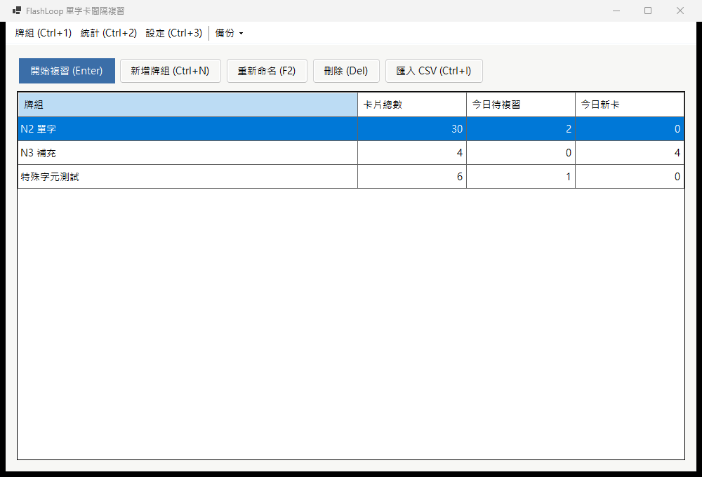
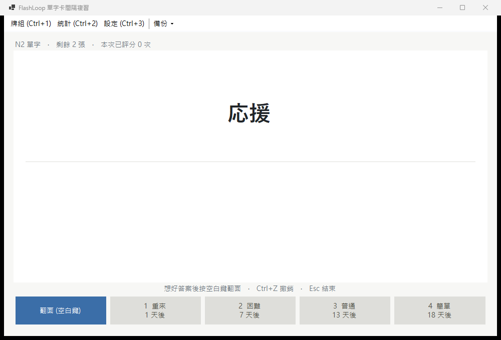
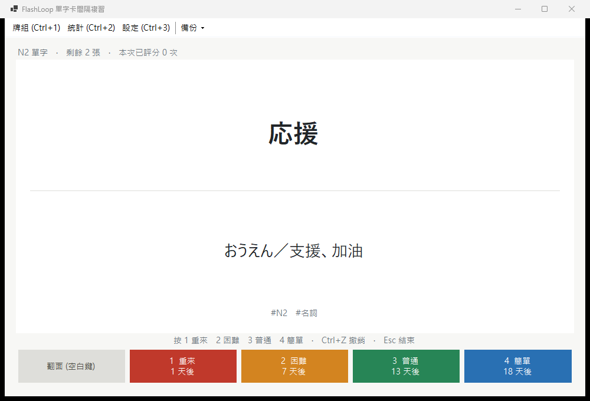
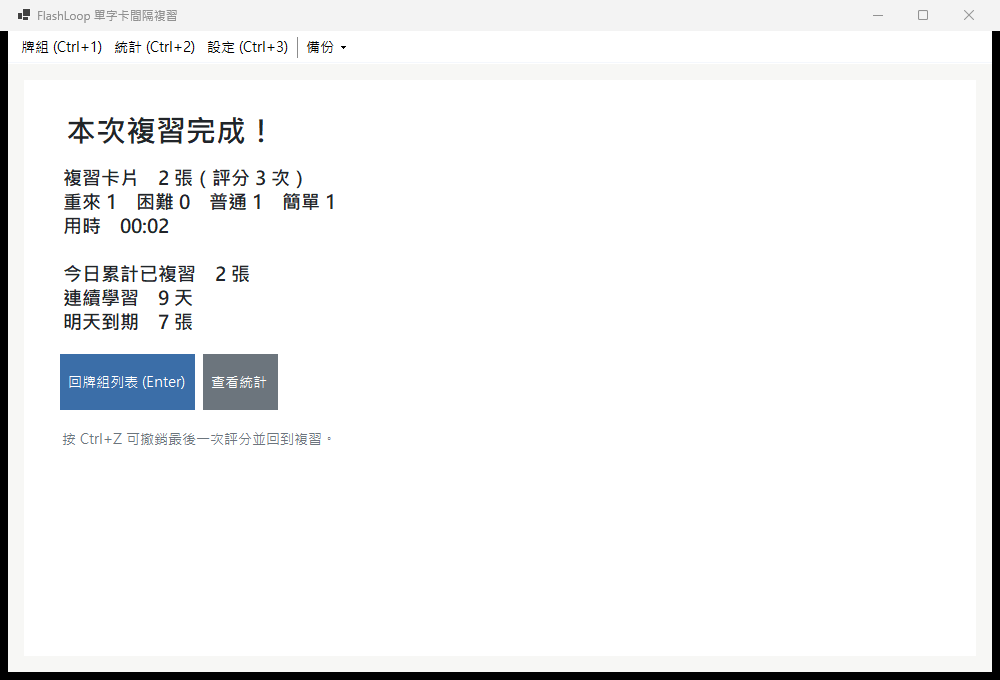
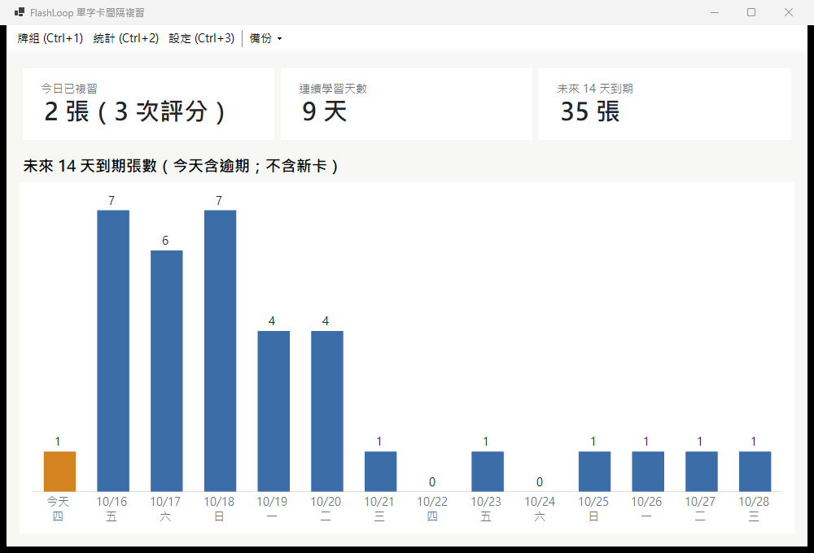
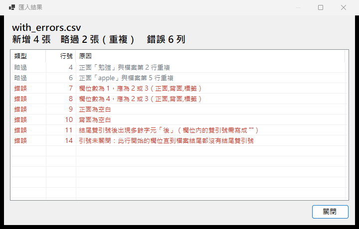
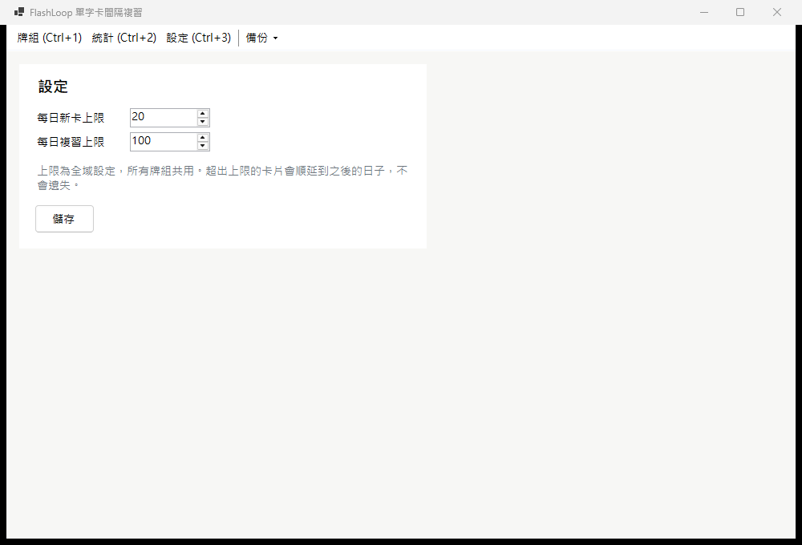
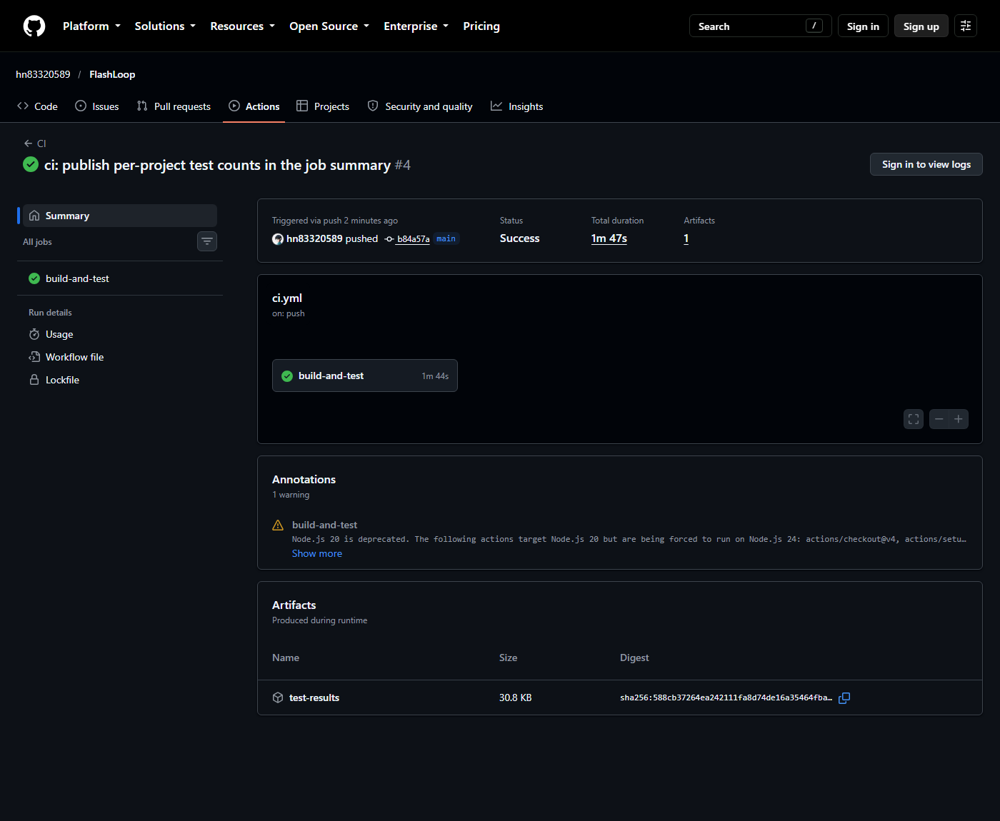

# FlashLoop 單字卡間隔複習器

[](https://github.com/hn83320589/FlashLoop/actions/workflows/ci.yml)

為通勤、睡前零碎時間背單字設計的 Windows 桌面小工具。匯入 CSV 單字表後，每天只推送「今天該看」的卡片，排程採 SM-2 變體演算法，全程可只用鍵盤操作。



## 功能

| 功能 | 說明 |
|---|---|
| 牌組管理 | 新增、重新命名、刪除；列表顯示卡片總數、今日待複習數、今日新卡數 |
| 匯入 CSV | `正面,背面,標籤`；UTF-8（含或不含 BOM）；支援欄位內逗號、雙引號、換行；同牌組正面重複自動略過；結束時顯示摘要與每列錯誤的行號、原因 |
| 複習 | 空白鍵翻面、1–4 評分（重來／困難／普通／簡單），按鈕上預先顯示各評分的下次間隔；「重來」的卡會在本次複習中重新出現 |
| 每日上限 | 每日新卡上限（預設 20）、複習上限（預設 100），全域共用；超出的卡片順延，不會遺失 |
| 撤銷 | Ctrl+Z 撤銷最近一次評分，卡片排程與當日統計一併還原，每次複習最多回溯 10 筆 |
| 統計 | 今日已複習張數、連續學習天數、未來 14 天到期預測長條圖（GDI+ 自繪） |
| 備份與還原 | 匯出全部牌組與排程進度為單一 JSON；還原可選「覆蓋」或「合併」（以較晚更新者為準） |

## 截圖

| 複習（正面） | 複習（翻面後） |
|---|---|
|  |  |

| 本次總結 | 統計 |
|---|---|
|  |  |

| 匯入結果（`samples/with_errors.csv`） | 設定 |
|---|---|
|  |  |

## 建置與執行

需求：Windows 10/11、[.NET 9 SDK](https://dotnet.microsoft.com/download/dotnet/9.0)。

```powershell
git clone https://github.com/hn83320589/FlashLoop.git
cd FlashLoop
dotnet build FlashLoop.sln -c Release
dotnet test FlashLoop.sln -c Release
dotnet run --project src/FlashLoop.App -c Release
```

資料位置：`%LocalAppData%\FlashLoop\`（`flashloop.db` 與 `settings.json`）。
若要在不影響正式資料的情況下試用（例如展示或截圖），可設定環境變數 `FLASHLOOP_DATA_DIR` 指向其他資料夾：

```powershell
$env:FLASHLOOP_DATA_DIR = "$PWD\demo-data"; dotnet run --project src/FlashLoop.App
```

### 快速上手

1. 「新增牌組」(Ctrl+N) 建立牌組，例如「N2 單字」。
2. 選取牌組後「匯入 CSV」(Ctrl+I)，可先用 `samples/n2_basic.csv` 試試。
3. 按 Enter 開始複習：空白鍵翻面，1–4 評分，Ctrl+Z 撤銷，Esc 結束。

### 鍵盤操作

| 畫面 | 按鍵 |
|---|---|
| 全域 | Ctrl+1 牌組、Ctrl+2 統計、Ctrl+3 設定 |
| 牌組列表 | ↑↓ 選擇、Enter 開始複習、Ctrl+N 新增、F2 重新命名、Del 刪除、Ctrl+I 匯入 |
| 複習 | 空白鍵翻面、1 重來、2 困難、3 普通、4 簡單（數字鍵盤亦可）、Ctrl+Z 撤銷、Esc 結束 |
| 總結 | Enter／Esc 回牌組列表、Ctrl+Z 撤銷最後一次評分並回到複習 |

## 範例資料（`samples/`）

| 檔案 | 內容 | 匯入結果 |
|---|---|---|
| `n2_basic.csv` | 30 個 N2 單字，含標題列與標籤，UTF-8 無 BOM、LF | 新增 30 |
| `with_errors.csv` | 檔內重複、大小寫／空白不同的重複、欄位數錯誤、正面或背面空白、引號錯誤、引號未關閉、空白列 | 新增 4、略過 2（第 4、6 行）、錯誤 6（第 7、8、9、10、11、14 行） |
| `special_bom.csv` | UTF-8 **含 BOM**、CRLF；欄位內逗號、`""` 跳脫雙引號、欄位內換行、重音字母、emoji、前後空白、雜亂標籤 | 新增 6 |
| `backup_example.json` | 實際匯出的備份檔（2 個牌組、5 張卡、3 天的評分紀錄） | 可直接「還原備份」 |

以上結果由 `SampleFileTests`、`BackupServiceTests.Sample_backup_file_restores` 驗證。

## 架構與模組

```
FlashLoop.sln
├─ src/FlashLoop.Core   (net9.0)          純邏輯：排程、CSV、複習流程、統計、備份、服務層、Repository 介面
├─ src/FlashLoop.Data   (net9.0)          SQLite（Microsoft.Data.Sqlite）與 settings.json 實作
├─ src/FlashLoop.App    (net9.0-windows)  WinForms：MainForm + UserControls
├─ tests/FlashLoop.Tests     (xUnit)      Core 單元測試 + Data 整合測試（暫存 SQLite 檔）
└─ tests/FlashLoop.App.Tests (xUnit)      端到端測試：驅動真正的 MainForm（net9.0-windows）
```

依賴方向為 `App → Core ← Data`。Core 不引用 WinForms 或 SQLite，只定義介面；`Program.cs` 是唯一組裝的地方（手動注入，不使用 DI container）。

| 模組（Core） | 主要型別 | 職責 |
|---|---|---|
| `Scheduling` | `Sm2Scheduler`、`CardSchedule`、`Rating` | 純函式：`Apply(狀態, 評分, 今天) → 新狀態` |
| `Csv` | `CsvParser`、`CsvImporter`、`CardText` | RFC 4180 解析（保留每筆 record 的起始行號）、驗證、去重、摘要 |
| `Review` | `ReviewQueueBuilder`、`ReviewSession`、`DailyUsage` | 依上限建佇列；重來重排；撤銷堆疊 |
| `Stats` | `StreakCalculator`、`ForecastCalculator` | 連續天數、14 天預測 |
| `Backup` | `BackupService`、`BackupMerger`、`BackupValidator`、`BackupSerializer`、`IBackupArchive` | JSON 匯出／驗證／覆蓋／合併；覆蓋前自動備份 |
| `Services` | `DeckService`、`ImportService`、`ReviewService`、`StatsService` | 給 UI 呼叫的應用層 |
| `Persistence` | `IDeckRepository`、`ICardRepository`、`IReviewLogRepository`、`ISettingsStore` | 由 Data 實作的介面 |

| App 畫面 | 說明 |
|---|---|
| `MainForm` | ToolStrip 導覽 + 內容區切換 UserControl；備份選單 |
| `DeckListView` | 牌組 DataGridView 與操作按鈕 |
| `ReviewView` | 卡片、評分按鈕；完成後切換為總結 |
| `StatsView` + `ForecastChart` | 統計數字與 GDI+ 長條圖 |
| `SettingsView` | 每日上限 |

### 時間控制

所有和「現在」有關的邏輯都透過注入的 `System.TimeProvider` 取得時間（`TimeProvider.Today()` 取本地日期）。正式環境使用 `TimeProvider.System`；測試使用 `FakeTimeProvider`（固定 UTC+8，可任意前進），所以跨日、隔天出現、連續天數等情境都能在單元測試中重現。

### 資料庫

```sql
decks       (id, guid UNIQUE, name UNIQUE COLLATE NOCASE, created_at, updated_at)
cards       (id, guid UNIQUE, deck_id → decks ON DELETE CASCADE, front, back, tags, front_key,
             ease, repetitions, interval_days, due_date, last_reviewed_at, created_at, updated_at,
             UNIQUE(deck_id, front_key))
review_logs (id, guid UNIQUE, card_id → cards ON DELETE CASCADE, reviewed_at, review_date, rating, was_new)
```

- `last_reviewed_at IS NULL` 代表新卡。
- `front_key` = 正面去除前後空白後轉小寫，用來判斷重複。
- 每次評分會在**同一個 transaction** 內更新卡片並新增一筆 log；撤銷則還原卡片並刪除那筆 log。

## 排程演算法（SM-2 變體）

以「天」為單位。新卡初始 `ease = 2.5, repetitions = 0, interval = 0`。

| 評分 | ease | interval | repetitions |
|---|---|---|---|
| 1 重來 | −0.2，下限 1.3 | 1 | 歸零 |
| 2 困難 | −0.15，下限 1.3 | `max(1, round(interval × 1.2))` | 不變 |
| 3 普通 | 不變 | reps=0 → 1；reps=1 → 6；其餘 `round(interval × ease)` | +1 |
| 4 簡單 | +0.15 | `round(interval × ease × 1.3)`，使用 **+0.15 之後** 的 ease；reps=0 時至少 4 | +1 |

**到期日** = 評分當天 + interval。

實作細節：

- `round` 一律採四捨五入（`MidpointRounding.AwayFromZero`）。.NET 預設的銀行家捨入會把 `round(12.5)` 算成 12。
- ease 每次運算後保留兩位小數，避免 `2.5 − 0.2 = 2.3000000000000003` 這類浮點誤差累積。
- 範例：新卡連續評「普通」的間隔為 1 → 6 → 15 → 38 → 95（`round(6×2.5)=15`、`round(15×2.5)=round(37.5)=38`）。
- **間隔上限 36500 天（約 100 年）**：規格沒有訂上限，這是額外加的。間隔乘上 ease 沒有上界，連續評「簡單」最終會超出 `int` 範圍，變成負數間隔；所以先在 `double` 範圍內套用上限再轉型。實際使用碰不到這個值，也不影響上表的任何數列。

### 本次複習中的「重來」

- 評「重來」的卡會排到佇列尾端並標記為「學習中」。之後只要評分低於「普通」（重來或困難），就會再排回尾端；評到「普通」或「簡單」才離開本次複習。
- 每次評分都會依當下狀態套用上表規則並寫入資料庫，所以重來後再評普通時，是從 `repetitions = 0` 開始計算（interval = 1）。
- 因為重排一律放到隊尾，只有佇列裡只剩這張卡時才會連續出現。

### 每日上限

佇列在開始複習時建立：先放到期卡（依到期日、Id 排序），再放新卡（依匯入順序）。

- 新卡剩餘額度 = 新卡上限 − 今天第一次學習的新卡數
- 複習剩餘額度 = 複習上限 − 今天複習過的非新卡張數（同一張不重複計算；今天剛學的新卡重來後再評，不佔複習額度）

這些數字都由 `review_logs` 推導而來，不另外存計數器。超出上限的卡片狀態完全不變（新卡仍是新卡，到期卡的 due 仍 ≤ 今天），所以隔天建立佇列時會自然被選入。

## 統計計算方式

| 項目 | 計算方式 |
|---|---|
| 今日已複習張數 | 今天有評分紀錄的**不重複卡片**數；評分次數另外顯示 |
| 連續學習天數 | 有任一筆評分的日子算一天，同一天多次只算一次。今天已複習就從今天往回數；今天還沒複習則從昨天往回數（當天結束前不會歸零）。昨天和今天都沒複習為 0 |
| 14 天到期預測 | 第 0 天（今天）= `due_date ≤ 今天`（包含逾期）；第 1–13 天 = `due_date` 正好在那一天。不含新卡，也不套每日上限，因此每根長條都等於資料庫中對應的卡片數（`Forecast_matches_raw_due_counts_in_database` 直接以 SQL 比對） |

因為統計都由 log 推導，撤銷評分（刪除那筆 log 並還原卡片）時，當日統計會自動回到評分前的值。

## 備份與還原

備份檔裡的關聯一律以 `guid` 表示，和資料庫 Id 無關，所以可以跨機器還原。還原前會先完整驗證，驗證失敗時資料庫完全不會變動。檢查項目包括：

- 版本、guid 重複、關聯是否存在、同牌組正面重複、數值範圍。
- 排程欄位彼此一致：到期日與最後複習時間必須同時有值或同時為空；新卡的 repetitions、interval 為 0；複習過的卡 interval 至少 1 天；interval 不超過 36500 天。

- **覆蓋**：先把目前資料自動匯出到 `<資料目錄>\backups\before-restore-yyyyMMdd-HHmmss.json`（全部保留、不覆寫），成功後才在一個 transaction 內清空並寫入備份內容，再套用備份中的每日上限設定。自動備份失敗時不會還原。完成訊息會顯示自動備份的位置，要回到覆蓋前的狀態，只要再以「覆蓋」還原這個檔案。
- **合併**：在記憶體中計算合併結果，再以同樣的 transaction 寫入。
  - 牌組、卡片以 guid 對應，兩邊都有時取 `updated_at` 較晚者（時間相同時保留本機）。
  - 不同 guid 但同名的牌組會都保留，後加入的名稱加上「 (2)」。
  - 同一牌組內不同 guid 但正面相同的卡片，保留較晚更新者，另一張連同其評分紀錄捨棄。
  - 評分紀錄以 guid 聯集。
  - 本機設定保留不變。
  - 合併結果可重複套用（idempotent）。

## 啟動時的資料損毀處理

`Program.Main` 對設定檔與資料庫的初始化分別處理錯誤，讓使用者選擇「重設」或「離開」（預設為離開）：

| 情況 | 重設的行為 |
|---|---|
| `settings.json` 格式錯誤或內容無效 | 原檔改名為 `settings.json.<時間>.bak`，改用預設上限；牌組與進度不受影響 |
| `flashloop.db` 無法開啟（例如檔案損毀） | 原檔連同 SQLite journal 改名為 `flashloop.db.<時間>.bak`，建立新的空白資料庫；可再從備份還原 |
| 資料庫被其他程式占用（BUSY／LOCKED） | 不提供重設（檔案本身沒壞），只提示關閉其他視窗 |

損毀的檔案一律改名保留、不刪除，事後仍可救回或交給開發者分析。改名邏輯在 `DataFileRecovery`，有測試涵蓋。

## 測試

```powershell
dotnet test
```

共 143 個測試案例：`FlashLoop.Tests` 130 個（Core 單元測試、Data 整合測試），`FlashLoop.App.Tests` 13 個（端到端）。

端到端測試在暫存資料目錄中啟動真正的 `MainForm`：

- 視窗開在螢幕外、不取得焦點。
- 按鍵透過 `ProcessCmdKey` 送入，和實體鍵盤在 WinForms 中走同一段處理。
- 每一步都以 SQL 直接查詢資料庫，再和畫面上的數字比對。
- UI 的內部控制項以 reflection 取得，畫面結構改變時，`AppHarness` 要跟著調整。

驗收標準對應的測試：

| # | 標準 | 主要測試 |
|---|---|---|
| 1 | 牌組 CRUD、統計、重開後不變 | `DeckPersistenceTests`、`DeckAndImportFlowTests.Create_rename_delete_and_counts_survive_restart` |
| 2 | CSV 逗號／雙引號／換行、有無 BOM | `CsvParserTests`、`SampleFileTests`、`DeckAndImportFlowTests.Special_character_sample_*` |
| 3 | 匯入摘要數量、錯誤行號與原因 | `CsvImporterTests`、`SampleFileTests`、`DeckAndImportFlowTests.Error_sample_summary_*` |
| 4 | 連續普通 1、6、round(6×ease)… | `Sm2SchedulerTests.Consecutive_good_follows_1_6_then_interval_times_ease` |
| 5 | 重來／困難／簡單逐條、ease 下限 | `Sm2SchedulerTests`（含邊界 Theory） |
| 6 | 重來重新出現、普通以上不再出現 | `ReviewSessionTests`、`KeyboardReviewFlowTests.Again_card_returns_*` |
| 7 | 每日上限、隔天出現 | `ReviewQueueBuilderTests`、`MultiDayFlowTests` |
| 8 | 鍵盤完整操作複習流程 | `KeyboardReviewFlowTests` |
| 9 | 連續天數 | `StreakCalculatorTests`、`ReviewPersistenceTests.Streak_*`、`MultiDayFlowTests` |
| 10 | 14 天預測與資料庫一致 | `ForecastCalculatorTests`、`ReviewPersistenceTests.Forecast_*`、`MultiDayFlowTests`（比對畫面上的圖表） |
| 11 | Ctrl+Z 還原排程與當日統計 | `ReviewSessionTests.Undo_*`、`ReviewPersistenceTests.Undo_*`、`KeyboardReviewFlowTests.Ctrl_Z_*` |
| 12 | JSON 備份覆蓋與合併 | `BackupServiceTests`、`BackupMergerTests`、`BackupFlowTests` |

CI（`.github/workflows/ci.yml`）在 `windows-latest` 上以 .NET 9.0.x 執行 restore、build、test，並在 Job Summary 列出各測試專案的通過數。完整的驗收紀錄見 [`docs/test-report.md`](docs/test-report.md)。



## 設計取捨

- **Microsoft.Data.Sqlite + 手寫 SQL，不用 EF Core**：只有三張表，直接寫 SQL 更清楚，依賴與啟動成本也較低；代價是對應程式碼要自己寫（集中在 `SqliteStore`）。
- **自己寫 CSV 解析器，不用 CsvHelper**：需求的重點在錯誤行號（含跨行欄位）和逐列錯誤原因，自己寫的狀態機約 150 行，好控制也好測試。
- **統計由評分紀錄推導，不存計數器**：撤銷、還原、合併後統計自然正確，不會有計數器和資料不同步的問題。代價是每次查詢要掃描當日 log，以個人使用的資料量來說可以忽略。
- **排程純函式 + 注入 TimeProvider**：所有規則與跨日情境都能在單元測試中精確重現。
- **佇列在開始複習時快照**：複習中途不會因為時間跨過午夜或設定變更而突然改變佇列，行為比較好預期。
- **UI 用程式碼建構、以 Layout Panel 排版**：沒有 Designer 檔，畫面結構直接看程式碼就能理解，高 DPI 下也不會跑版。
- **每次評分立即存檔**：中途關閉不會遺失進度，「結束複習」只需要確認、不需要儲存。

## 已知限制

- 換日時間為本地午夜 00:00（不像 Anki 可設定凌晨 4 點）；修改系統時區或時鐘會影響「今天」的判定。
- 評「重來」後如果在重新評分前就結束複習，該卡會依 interval = 1 在**明天**出現，不會在當天重新出現。
- 撤銷歷史只存在於當次複習；結束複習或關閉程式後就無法撤銷。
- 牌組列表的「今日待複習／新卡」已套用剩餘的全域額度，但多個牌組共用額度，所以各牌組數字相加可能超過實際剩餘額度。
- 目前沒有逐張瀏覽或編輯卡片的畫面（不在需求範圍內）；要修改卡片內容需刪除後重新匯入。
- 合併還原時，不同 guid 的同名牌組不會合成一個，而是加上後綴並列保留。
- 不處理多開與多機同步（依需求假設：單人單機使用）。
